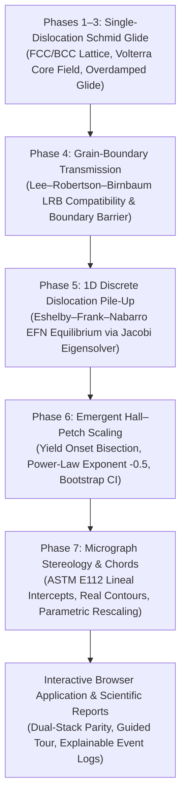

# HPSim — Micrograph-Driven Dislocation Pile-Up & Hall–Petch Simulator

[](tests/)
[](web/tests/)
[](scripts/validate_data_acquisition.py)
[](web/)
[](docs/adr-010-architecture-reconciliation.md)

**HPSim** is an open-source, dual-stack scientific simulator developed as an undergraduate materials science and metallurgical engineering college project. It derives the macroscopic **Hall–Petch strengthening relation** ($\sigma_y = \sigma_0 + k_y d^{-1/2}$) bottom-up from fundamental crystallographic slip, single-dislocation glide, grain-boundary barrier transmission, 1D discrete dislocation pile-ups, and ASTM E112 stereological lineal intercepts from optical micrographs.

The project features a **Python scientific reference implementation** alongside a **100% client-side, zero-backend interactive web application** built with React 19, TypeScript, Vite, and Three.js.

---

## 1. Problem Statement & Scientific Scope

The classical Hall–Petch relation describes the empirical observation that polycrystalline metals become stronger as their average grain diameter $d$ decreases:
$$\sigma_y = \sigma_0 + k_y d^{-1/2}$$

While traditional textbooks present the pile-up model as a phenomenological continuum equation, engineering students rarely visualize or solve the discrete mechanics behind it. **HPSim bridges microscopic dislocation mechanics and macroscopic yield strength** across seven transparent simulation phases:



### What is Emergent vs. What is Calibrated
- **Emergent:** The $d^{-1/2}$ power-law scaling exponent (log–log slope $-0.483 \pm 0.015$, target $-0.50 \pm 0.05$) emerges directly from discrete dislocation force balances and source shut-off kinetics without prescribing the power law.
- **Calibrated:** The single scalar grain-boundary barrier strength $\tau^*_{\text{ref}}$ is calibrated to published literature Hall–Petch slopes ($k_y$) on one primary dataset per material. It is explicitly labeled a **calibration target**, not an emergent prediction.
- **Blind Held-Out Benchmark:** Predictions on independent held-out literature datasets use zero held-out parameters (`held_out_unadjusted_mean_rel_error`), maintaining strict scientific honesty.

---

## 2. Key Features

1. **3D WebGL Crystal Viewer:** Hardware-accelerated rendering of up to 4,000 FCC/BCC lattice sites displaced by isotropic Volterra continuum dislocation strain fields with analytical core regularization ($r_c = b$).
2. **Deterministic Physics Controllers:** Pure TypeScript core mirrors Python reference implementation to within $< 10^{-12}$ relative tolerance across independent golden fixtures.
3. **High-Precision EFN Eigensolver:** Solves discrete equilibrium positions for $N \le 50$ dislocations via Associated Laguerre tridiagonal Jacobi eigenvalues (Golub–Welsch algorithm), verified against independent 50-digit `mpmath` algebraic polynomial roots.
4. **Explainable Transmission Log:** Evaluates 12 outgoing slip systems using the Lee–Robertson–Birnbaum (LRB) geometric compatibility factor ($m'$), residual Burgers vector ($|\mathbf{b}_r|$), and outgoing resolved shear stress ($\tau_{\text{out}}$).
5. **ASTM E112 Micrograph Stereology:** Complete chord populations extracted from real segmented optical micrographs (Aluminium, Copper, Ferritic Steel, Pure Iron) with full vector overlays and transparent chord rescaling.
6. **Student Guided Tour & Accessibility:** In-app walkthrough explaining controls, units, and outcome distinctions (color, shape, border style, and ARIA labels).

---

## 3. Repository Architecture

```text
Meta Project/
├── src/hpsim/                  # Python scientific reference package
│   ├── core/                   # Dislocation glide, EFN pile-up, Hall-Petch solvers
│   ├── materials/              # Audited crystallographic constants & materials.yaml
│   └── micro/                  # Micrograph segmentation, ASTM E112 intercepts, chords
├── web/                        # Zero-backend interactive web application
│   ├── src/core/               # Pure TypeScript physics engine (mirrors src/hpsim/core/)
│   ├── src/render/             # Three.js 3D lattice & dislocation viewer
│   ├── src/ui/                 # React 19 user interface (App.tsx, styles.css)
│   ├── public/data/            # Static materials and vector micrograph fixtures
│   └── tests/                  # Node.js parity, unit, and static smoke test suites
├── tests/                      # Python pytest regression suite & independent oracles
├── data/                       # Audited literature datasets, fits, and manifests
├── scripts/                    # Validation report generator, presets runner, data audit
└── docs/                       # Technical reports, user guide, limitations, reproducibility
```

---

## 4. Quick Start & Local Execution

### Prerequisites
- **Python:** Python 3.11+ with `numpy`, `scipy`, `pytest`, `pyyaml`, `opencv-python`
- **Node.js:** Node.js v22+ (supporting `--experimental-strip-types`) with `npm`

### 4.1 Running the Interactive Web App Locally
```powershell
cd web
npm install
npm run dev
```
Open the local Vite URL (typically `http://localhost:5173`).

To test the production build locally using the built-in preview server:
```powershell
npm run build
npm run preview
```
Open `http://localhost:4173/`.

> [!NOTE]
> **Offline `file:///` Notice:** Modern web browsers prohibit dynamic JSON fetches (`fetch()`) when opening HTML files directly from local disk (`file:///`) due to CORS/origin security restrictions. Always run the web app via a local HTTP server (`npm run dev` or `npm run preview`).

### 4.2 Running the Python Simulation Presets (CLI)
From the repository root:
```powershell
$env:PYTHONPATH="src"
python scripts/run_presets.py
```

### 4.3 Regenerating the Full Scientific Validation Report (`V-01` to `V-17`)
```powershell
$env:PYTHONPATH="src"
python scripts/generate_validation_report.py
```
Outputs the complete mathematical verification report to `docs/validation_report.md`.

---

## 5. Verification & Test Suites

Run the complete regression suite locally:

```powershell
# 1. Python Scientific & Mathematical Regression Suite
$env:PYTHONPATH="src"
$env:PYTHONDONTWRITEBYTECODE="1"
python -m pytest -p no:cacheprovider -q

# 2. Bibliographic & Data Integrity Audit
python scripts/validate_data_acquisition.py

# 3. Node.js Cross-Runtime Parity & Static Smoke Tests
node --experimental-strip-types --test web/tests/*.test.mjs

# 4. TypeScript Strict Compilation
Push-Location web; npx tsc --noEmit --incremental false; Pop-Location

# 5. Production Static Build Verification
Push-Location web; npx vite build --base=/hpsim/ --outDir "$env:TEMP\hpsim_dist" --emptyOutDir; Pop-Location
```

### Current Verification Status
- **Python Suite:** **173 passed, 2 strict expected failures (`xfail`)** in ~37s.
- **Node.js Suite:** **87 passed, 0 failed** in ~2.8s.
- **Data Acquisition Audit:** **6/6 checks green (100%)**.
- **TypeScript:** Clean compilation (`0` errors under `tsc --noEmit`).
- **Static Builds:** Clean builds at root base (`/`) and GitHub Pages subpath (`/hpsim/`).

---

## 6. Scientific Limitations & Decision M6

HPSim is designed as an explanatory, reproducible college educational model. Key physical boundaries include:

1. **1D Planar Coplanar Pile-Up:** Pile-ups are modeled as straight edge dislocations on a single slip plane. Cross-slip, dislocation climb, 3D line tension, and forest hardening are outside the model scope.
2. **Continuum Isotropic Elasticity:** Inter-dislocation forces use isotropic Volterra solutions with core regularization $r_c = b$. Atomistic core reconstructions and Peierls-Nabarro double-kink kinetics are not modeled.
3. **Calibrated $k_y$ vs Emergent Exponent:** The Hall–Petch slope $k_y$ is a calibration target fit to one literature dataset per material. Only the $d^{-1/2}$ exponent is emergent.
4. **Preservation of Decision M6:**
   - In `src/hpsim/materials/materials.yaml`, `tau_star_ref` is strictly `null`.
   - `ferritic_steel.tau_c` is set to $35.0\ \text{MPa}$ with `status: needs_citation`.
   - The engine renders explicit `"unresolved citation"` and `"unresolved threshold"` notices rather than fabricating unphysical numbers.
5. **The Two Strict Expected Failures (`xfail`):**
   - **Aluminium AA1050:** Commercial purity Fe/Si solute raises lattice friction by $\Delta\sigma_0 = +6.5\ \text{MPa}$ (+65%), causing unadjusted blind error (28.9%) to exceed the 25% target.
   - **Pure $\alpha$-Iron (Base Fe):** 5 ppm interstitial carbon segregates to ferrite boundaries, raising boundary locking by +64.9%. The 1D continuum elastic model lacks solute segregation chemistry, leading to a 39.4% slope underprediction.

For a comprehensive review of model boundaries, see [Scientific Assumptions & Limitations](docs/limitations.md).

---

## 7. Data Provenance & Licensing

- **Code:** All original source code in `src/` and `web/src/` is developed for academic evaluation. (Recommended open-source license: MIT or GNU GPLv3).
- **Literature Datasets:** Experimental Hall–Petch data (`data/literature/`) are transcribed from published scientific literature under fair-use scholarly citation with full DOIs.
- **Micrographs (Decision D6):** Optical micrographs from the University of Cambridge DoITPoMS library are licensed under **CC BY-NC-SA 4.0**. To respect non-commercial redistribution terms, **no raw JPG micrograph files are distributed in the web application assets**. Micrographs are exported solely as derivative geometric boundary polygons, ASTM test lines, and chord length arrays.

---

## 8. Guided Tour & Portfolio Documentation

- **[User Guide & Demo Walkthrough](docs/user_guide.md):** 5-minute step-by-step scenario for presentations and interviews.
- **[Scientific Limitations & Literature Matrix](docs/limitations.md):** Detailed comparison between continuum pile-up mechanics and experimental metallurgy.
- **[Reproducibility Guide](docs/reproducibility.md):** Complete environment setup, seeds, and execution commands.
- **[Resume & Technical Interview Brief](docs/resume_project_brief.md):** Honest project summary, resume bullet points, and technical interview talking points.
- **[Final Stabilization Report](docs/final_stabilization_report.md):** Audit trail, benchmark metrics, and college-readiness verdict.

