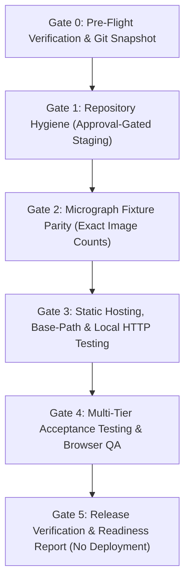

# Phase 8 Release Readiness Proposal: Static Hosting, Release Validation, and Repository Hygiene

**Date:** 2026-10-29  
**Target Milestone:** Phase 8 — Static Hosting, Release Packaging, and Full Validation Verification  
**Status:** **PLANNING ONLY (Not Authorized for Implementation)**  
**Coordinating Agent:** Antigravity Coordinator  

---

## 1. Executive Summary & Authorization Status

Following the 2026-10-29 Post-Remediation Acceptance Review, HPSim's scientific and numerical core engines (Phases 0–7) received an **ACCEPT WITH CONDITIONS** verdict. All mathematical models, discrete dislocation dynamics solvers, boundary transmission mechanics, emergent Hall-Petch scaling derivations, and ASTM E112 stereological algorithms passed automated verification:
- **Python Suite (`pytest`):** 165 passed, 2 strict expected failures (`xfail`).
- **Data Acquisition Audit (`validate_data_acquisition.py`):** 6/6 checks pass (GREEN).
- **Node.js Test Suite (`node --test`):** 80 passed, 0 failed.
- **TypeScript (`tsc`):** Clean (0 errors).
- **Production Build (`vite build`):** Successful static compilation (38 modules transformed).

However, full release readiness requires addressing four concrete engineering, stereological, and provenance conditions identified during acceptance and peer review:
1. **Micrograph Chord Truncation & Image-Specific Counts:** Fixture generation in `scripts/generate_phase7_fixtures.py` artificially slices exported chord arrays to `[:250]`. This introduces severe spatial sampling bias (+96.5% error in Aluminium, displaying $\bar{\ell} \approx 15.94\,\mu\text{m}$ instead of $8.11\,\mu\text{m}$) and causes client-side stats to diverge from the full pipeline. Acceptance criteria must mandate complete export matching the exact pipeline outputs for each specific micrograph—not an assumed universal range.
2. **Static Asset Fetch & Offline Policy:** Web UI uses bare relative `fetch('data/micrographs/...')` rather than the built application's base URL, risking 404 errors under non-trailing-slash GitHub Pages subpaths. Furthermore, direct `file:///` local browsing is explicitly treated as **unsupported** due to modern browser CORS restrictions on local file fetches; static hosting acceptance requires testing via local HTTP server (`vite preview`) and deployed subpaths.
3. **Repository Hygiene & Approval-Gated Git State:** Commit `4c14468` committed 3,424 files under `web/node_modules/` to Git version control. Additionally, build outputs (`web/dist/`) and 44 `.pyc` compiled bytecode files are actively tracked in Git. The hygiene workflow must untrack these from the index non-destructively without touching working tree files, and all staging/commit actions must be strictly **approval-gated**. Git history rewriting remains out of scope.
4. **Browser Testing Protocol:** Existing smoke tests verify static file existence in Node.js without executing live DOM rendering or WebGL canvas validation in a real Chromium browser engine.

> [!IMPORTANT]
> **Authorization Status:** **PLANNING ONLY.**  
> Phase 8 implementation is **NOT** authorized to start automatically. No source code, tests, fixtures, build files, or Git history have been modified or staged. This document establishes the concrete, evidence-based roadmap for Phase 8 execution upon explicit user approval.

---

## 2. Verified Repository State & Baseline Evidence

A comprehensive inspection of the repository verified the following baseline state:
- **Active Git Branch:** `main` at commit `193721c` (*feat: implement core Hall-Petch simulator engine, micrograph preprocessing, and web UI components*).
- **Working Tree State:** Contains verified uncommitted modifications across 18 tracked files (Phase 5/6/7 source, tests, fixtures, and docs) and 18 untracked files (`.planning/phases/07-.../`, `.planning/phases/08-.../`, `scripts/run_presets.py`, screenshots, etc.). Post-audit status matches pre-audit status byte-for-byte.
- **Baseline Backup Anchor:** Complete non-destructive filesystem snapshot verified at:
  ```
  C:\Users\toshr\Desktop\HPSim_Backup_20261029_191324
  ```
  *(Preserves all source, configs, and node_modules; will never be overwritten, modified, or cleaned).*
- **Tracked Index Bloat Audit:**
  - `web/node_modules/`: 3,424 files tracked in Git index.
  - `web/dist/`: 4 build files tracked in Git index.
  - Compiled Python bytecode (`*.pyc`): 44 files tracked across `src/` (27 files) and `tests/` (17 files).
  - `.gitignore`: Contains only `/graft/`.
- **Packaging & Tooling Audit:**
  - `package.json`: Does not exist at repository root (root operates as Python environment and Git root).
  - `web/package.json`: Contains React 19, Three.js, Vite 8, TypeScript 7; test runner is configured to native Node.js test runner (`node --experimental-strip-types --test web/tests/*.test.mjs`). `@playwright/test` is **not** installed.
  - Playwright MCP Server: Available and functional in Antigravity agent runtime for headless browser operations.

---

## 3. Workstreams, File Ownership & Subagent Responsibilities

To guarantee safe execution without overlapping edits or race conditions, Phase 8 implementation is partitioned into four disjoint workstreams coordinated by the central agent:

```
+-------------------------------------------------------------------------------------------------------+
|                                    PHASE 8 IMPLEMENTATION ARCHITECTURE                                |
+-------------------------------------------------------------------------------------------------------+
| Track 1: Scientific Fixture & Chord Parity (Owner: Fixture Specialist)                                 |
| - Files: `scripts/generate_phase7_fixtures.py`, `src/hpsim/micro/intercept.py`,                      |
|          `tests/golden/phase7_fixtures.json`, `web/public/data/micrographs/*.json`                    |
| - Scope: Remove [:250] slice, export full chords, calculate population percentiles, update fixtures.  |
+-------------------------------------------------------------------------------------------------------+
| Track 2: Static Hosting & Asset Paths (Owner: Web Core Specialist)                                     |
| - Files: `web/src/core/paths.ts` (new), `web/src/ui/App.tsx`, `web/vite.config.ts`,                    |
|          `web/public/.nojekyll` (new), `web/package.json`, `web/tests/static_smoke.test.mjs`           |
| - Scope: Implement `resolveAssetUrl`, harden BASE_URL resolution, add GH Pages build script.          |
+-------------------------------------------------------------------------------------------------------+
| Track 3: Repository Hygiene & Index Sanitation (Owner: Repo Hygiene Specialist)                        |
| - Files: `.gitignore`, Git index tracking state                                                       |
| - Scope: Expand `.gitignore`, execute non-destructive `git rm --cached`, verify working tree on disk. |
+-------------------------------------------------------------------------------------------------------+
| Track 4: Browser Acceptance & Release QA (Owner: QA Specialist & Coordinator)                          |
| - Tools: Playwright MCP / Headless Chromium, Node.js test runner, `scripts/validate_data_acquisition`  |
| - Scope: Execute 5 Browser Acceptance Tests (BAT-01..05), verify console silence, take QA snapshots.  |
+-------------------------------------------------------------------------------------------------------+
```

---

## 4. Ordered Implementation Plan with Dependencies & Safeguards

Phase 8 implementation proceeds through 5 strictly sequenced gates with explicit pause-points and user approval gates:



### Gate 0: Pre-Flight Verification & Git Snapshot
1. Verify the integrity and availability of `C:\Users\toshr\Desktop\HPSim_Backup_20261029_191324`.
2. Record initial `git status --short` and `git diff` to an audit log.
3. Run baseline test suites (`pytest`, `validate_data_acquisition.py`, `node --test`, `tsc`, `vite build`) to confirm clean starting state.

### Gate 1: Repository Hygiene & Approval-Gated Git Index Sanitation
1. **Expand `.gitignore`**:
   Add comprehensive patterns for `/node_modules/`, `web/node_modules/`, `web/dist/`, `.vite/`, `__pycache__/`, `*.pyc`, `.pytest_cache/`, and IDE metadata.
2. **Untrack Artifacts from Index (Non-Destructively)**:
   Execute cached removal so working tree files on disk remain 100% untouched:
   ```powershell
   git rm -r --cached web/node_modules/
   git rm -r --cached web/dist/
   git ls-files "*.pyc" | ForEach-Object { git rm --cached $_ }
   ```
3. **Verify Working Tree Intactness**:
   Confirm `Test-Path web/node_modules` and `Test-Path web/dist/index.html` return `True`. Run `pytest` to ensure no environment disruption.
4. **Approval-Gated Staging (No Automatic Commit)**:
   - Present staged diff and `git status --short` to the user.
   - **Do NOT commit automatically.** Await explicit user authorization before creating the commit (`chore(repo): untrack dependencies, build artifacts, and bytecode caches`).
   - Reaffirm: Git history rewriting is out of scope; commit `4c14468` remains intact in Git history.

### Gate 2: Micrograph Fixture Parity & Exact Per-Image Export
1. **Remove Truncation Slices**:
   In `scripts/generate_phase7_fixtures.py`, remove `[:250]` on lines 94 and 149.
2. **Export Exact Verified Per-Image Chords & Population Statistics**:
   The full pipeline on a 20×20 grid establishes the actual counts for each image. Acceptance requires complete export matching these exact pipeline counts:
   - **Aluminium (DoITPoMS #609):** Exactly **963 chords**, 932 crossings, ASTM $\bar{\ell} = 8.112\,\mu\text{m}$, chord mean $7.847\,\mu\text{m}$.
   - **Copper (DoITPoMS #436):** Exactly **1,044 chords**, 1,011 crossings, ASTM $\bar{\ell} = 17.267\,\mu\text{m}$, chord mean $16.717\,\mu\text{m}$.
   - **Ferritic Steel (DoITPoMS #202):** Exactly **1,301 chords**, 1,129 crossings, ASTM $\bar{\ell} = 13.139\,\mu\text{m}$, chord mean $11.368\,\mu\text{m}$.
   - **Pure Iron (Wikimedia Fer_pur):** Exactly **855 chords**, 817 crossings, ASTM $\bar{\ell} = 7.599\,\mu\text{m}$, chord mean $7.261\,\mu\text{m}$.
   - **Synthetic Voronoi Target (V-11, 10×10 grid):** Exactly **231 chords**, 215 crossings, ASTM $\bar{\ell} = 27.907\,\mu\text{m}$, continuous ridge truth $\bar{\ell}_{\text{true}} = 29.167\,\mu\text{m}$.
3. **Regenerate Public Fixtures & Golden Vectors**:
   Run `python scripts/generate_phase7_fixtures.py` to regenerate `web/public/data/micrographs/*.json` and `tests/golden/phase7_fixtures.json`.
4. **Update Core Parser (`web/src/core/micrograph.ts`)**:
   Add `MicrographPopulationStats` interface; parse `raw.statistics` into `preset.populationStats`; bind preset display names to exact ASTM intercepts.
5. **Update UI Card Readout (`web/src/ui/App.tsx`)**:
   Display both ASTM E112 grid intercept ($L_T/P$) and chord distribution metrics ($\bar{\ell}_{\text{chord}} \pm \sigma$, percentiles, exact $n$).

### Gate 3: Static Hosting, Base-Path & Local HTTP Testing
1. **Pure Asset Path Helper (`web/src/core/paths.ts`)**:
   Create pure function `resolveAssetUrl(relPath, baseUrl, winLoc)` that handles absolute root (`/`), subpaths (`/hpsim/`), and relative base paths (`./`) with trailing-slash defense.
2. **Offline Policy & Local HTTP Requirement**:
   - Explicitly document that opening `dist/index.html` via `file:///` in a standard browser is **unsupported** due to browser security restrictions on local JSON fetches.
   - All static deployment acceptance testing must be conducted via local HTTP servers (`npx vite preview`, `python -m http.server`, or static container).
3. **Integrate Path Resolution in `App.tsx`**:
   Replace line 321 bare fetch with:
   ```typescript
   const assetUrl = resolveAssetUrl(`data/micrographs/${micrographKey}.json`);
   fetch(assetUrl)
   ```
4. **Harden `web/vite.config.ts`**:
   Ensure `HPSIM_BASE` automatically normalizes trailing slashes.
5. **Add GitHub Pages Safeguard**:
   Create empty `web/public/.nojekyll` file.
6. **Build Script Extension (`web/package.json`)**:
   Add `"build:gh-pages": "cross-env HPSIM_BASE=/hpsim/ tsc && vite build"`.

### Gate 4: Multi-Tier Acceptance Testing & Browser QA
1. **Tier 1: Static Smoke & Parity Tests**:
   - Run `pytest` to confirm Python fixture tests pass.
   - Run Node test suite to confirm `static_smoke.test.mjs`, `test_micrograph.test.mjs`, and `phase7_parity.test.mjs` pass.
   - Run `npx tsc` and `npx vite build` to compile the production bundle.
2. **Tier 2: Real Browser Acceptance (Playwright MCP)**:
   Launch `npx vite preview` (serving over HTTP at `http://localhost:4173`) and execute Browser Acceptance Tests:
   - **BAT-01**: App mount, Three.js WebGL canvas initialization, 0 console errors.
   - **BAT-02**: Micrograph dynamic JSON hydration under root (`/`) and simulated subpath (`/hpsim/`).
   - **BAT-03**: Sequential dropdown selection of all 5 micrographs; verify badges update correctly.
   - **BAT-04**: Hall-Petch SVG chart inspection; verify bootstrap CI band and quantization whiskers.
   - **BAT-05**: Responsive viewport validation (`1920x1080`, `1280x800`, `768x1024`).

### Gate 5: Release Verification & Readiness Report (No Deployment)
1. Re-run `python scripts/validate_data_acquisition.py` (all 6 checks green).
2. Execute `python scripts/generate_validation_report.py` to produce final `docs/validation_report.md`.
3. Produce `docs/phase8_report.md` documenting completion of all release criteria.
4. **Strict Constraints:**
   - Keep the two strict expected failures (`xfail`) visible in the final report as documented scientific limitations (Al unadjusted error 28.9%, pure Fe slope transfer 39.4%).
   - Decision M6 remains **OPEN** (`tau_star_ref: null` in `materials.yaml`, `ferritic_steel.tau_c: needs_citation`).
   - Zero live cloud deployment or external publishing.

---

## 5. Detailed Acceptance Criteria & Pass Gates

| Gate ID | Criterion / Requirement | Verification Method | Pass Target |
| :--- | :--- | :--- | :--- |
| **AC-01** | **Exact Fixture Chord Parity** | Inspect `web/public/data/micrographs/*.json` | `len(chords_m) == statistics.total_chords` matching exact pipeline counts (Al: 963, Cu: 1044, Steel: 1301, Fe: 855, Voronoi: 231). Zero truncation. |
| **AC-02** | **Stereological Metric Separation** | Inspect `micrograph.ts` and UI readout | ASTM E112 grid intercept ($L_T/P$) and chord distribution mean ($\frac{1}{N}\sum \ell_i$) are separately labeled and displayed. |
| **AC-03** | **Aluminium Bias Elimination** | Client-side parsed Aluminium mean intercept | Browser displays $\bar{\ell}_{\text{ASTM}} = 8.112\,\mu\text{m}$ (eliminating the legacy $15.94\,\mu\text{m}$ sampling artifact). |
| **AC-04** | **Subpath & Trailing-Slash Resilience** | `web/tests/static_smoke.test.mjs` | `resolveAssetUrl` passes matrix test (root, subpath with/without slash, portable relative). |
| **AC-05** | **Zero Bare String Fetches** | Static AST / regex scan of `web/src/` | No occurrences of `fetch('data/` or `fetch('/data/`. All dynamic fetches use `resolveAssetUrl`. |
| **AC-06** | **GitHub Pages Jekyll Bypass** | Filesystem inspection | `web/public/.nojekyll` exists and is copied to `web/dist/.nojekyll`. |
| **AC-07** | **Git Index Hygiene** | `git ls-files` check | `git ls-files web/node_modules` returns 0; `git ls-files web/dist` returns 0; `git ls-files "*.pyc"` returns 0. |
| **AC-08** | **Working Tree Integrity** | Filesystem check after `git rm --cached` | `web/node_modules/` and local files exist on disk; `npm test` runs with zero re-install required. |
| **AC-09** | **Approval-Gated Git Commit** | Interactive workflow | Hygiene untracking is reviewed and staged; commit requires explicit user authorization. |
| **AC-10** | **Real Browser Acceptance (BAT-01..05)** | Playwright MCP against `vite preview` | 5/5 browser acceptance tests pass on production preview build (HTTP); zero uncaught console errors. |
| **AC-11** | **Decision D6 & Copyright Compliance** | Automated audit script | Zero raw DoITPoMS `.jpg` images in `web/public/` or `web/dist/`. JSON fixtures carry CC BY-NC-SA 4.0 attribution. |
| **AC-12** | **Decision M6 Preservation** | File audit | `tau_star_ref.value` remains `null` in `materials.yaml`; `ferritic_steel.tau_c` remains `needs_citation`. |
| **AC-13** | **Known Scientific Limitations Disclosed** | Test runner & final report | The 2 strict `xfails` are documented as unmet scientific criteria (Al unadjusted error, Fe slope transfer), not passes. |
| **AC-14** | **Existing Scientific Suite Integrity** | Full test execution | 165 passed, 2 strict xfailed in pytest; 6/6 data checks green; 80+ Node tests pass; clean `tsc`. |

---

## 6. Risks, Mitigations & Rollback Plan

### Identified Risks & Mitigations

| Risk ID | Identified Risk | Severity | Mitigation Strategy |
| :--- | :--- | :---: | :--- |
| **R-01** | `git rm -r --cached` inadvertently deletes local working tree files. | High | Strict use of `--cached` flag only. Explicit pre-commit check (`Test-Path web/node_modules`). Full restoration available from desktop backup. |
| **R-02** | Exporting full chord population inflates bundle sizes beyond static hosting limits. | Low | Audit shows all chords add only ~15 KB uncompressed (~4 KB gzip) per fixture ($< 1.5\%$ total bundle increase). JSON payloads remain $< 380\text{ KB}$. |
| **R-03** | Local `file:///` browsing fails due to browser CORS policies. | Medium | Treat direct file-URL browsing as explicitly unsupported. Document that local execution requires `vite preview` or local HTTP server. |
| **R-04** | Discrepancy between ASTM $L_T/P$ ($8.11\,\mu\text{m}$) and chord mean $\frac{1}{N}\sum \ell_i$ ($7.85\,\mu\text{m}$) confuses users. | Low | Explicit dual-metric labeling in UI explaining the stereological distinction (boundary-intercept ratio vs segment arithmetic average). |
| **R-05** | Accidental automated commit of hygiene changes before user review. | Medium | Gate 1 mandates explicit user approval before `git commit` is issued. |

### Rollback Playbook
- **Rollback Gate 1 (Hygiene):**
  If index untracking encounters an error before committing:
  ```powershell
  git reset HEAD web/node_modules/ web/dist/ "*.pyc"
  git checkout -- .gitignore
  ```
- **Rollback Gate 2 (Fixtures):**
  If fixture regeneration causes parity regressions, restore previous fixtures from Git working tree:
  ```powershell
  git checkout -- web/public/data/micrographs/ tests/golden/phase7_fixtures.json
  ```
- **Emergency Full Restore:**
  If any unrecoverable filesystem corruption occurs, restore cleanly from the untouched desktop backup:
  ```powershell
  Copy-Item -Path "C:\Users\toshr\Desktop\HPSim_Backup_20261029_191324\*" -Destination "." -Recurse -Force
  ```

---

## 7. Explicit Out-of-Scope Items

To prevent scope creep and maintain strict project boundaries, the following actions are explicitly **OUT OF SCOPE** for Phase 8:
1. **Phase 9 / Advanced Dislocation Dynamics:** No 3D cross-slip, Frank-Read source nucleation kinetics, or climb mechanics will be implemented.
2. **Hall-Petch Recalibration:** No modifications to $\tau^*_{\text{ref}}$ calibration values or literature source fits. The existing canonical 10–400 µm sweep remains locked.
3. **Decision M6 Parameter Promotion:** Calibrated $\tau^*_{\text{ref}}$ values will **not** be written into `src/hpsim/materials/materials.yaml`. They remain test/fixture outputs.
4. **Git History Rewriting:** No `git-filter-repo`, BFG Repo-Cleaner, or forced rebases. Historical commits (including `4c14468`) will remain unchanged to preserve commit history integrity.
5. **Live Cloud Deployment:** No deployment to production Vercel, Netlify, or live GitHub Pages domains.
6. **Publishing Micrographs:** No uploading or bundling of raw copyrighted CC BY-NC-SA 4.0 micrograph image files.
7. **Empirical Validation Claims:** Discrete dislocation pile-up models will not be claimed as empirically validated against physical TEM pile-ups; they remain analytically verified against EFN (1951) continuum solutions.

---

## 8. Final Implementation Execution Checklist

When Phase 8 implementation is authorized, the executing agent must follow this exact command sequence and record exit codes:

```powershell
# 1. Environment & Hygiene Sanitization (Approval-Gated Commit)
git add .gitignore
git rm -r --cached web/node_modules/
git rm -r --cached web/dist/
git ls-files "*.pyc" | ForEach-Object { git rm --cached $_ }
# PAUSE: Obtain explicit user approval before executing git commit
git commit -m "chore(repo): untrack dependencies, build artifacts, and bytecode caches"

# 2. Fixture Generation & Parity Updates
$env:PYTHONPATH="src"
$env:PYTHONDONTWRITEBYTECODE="1"
python scripts/generate_phase7_fixtures.py

# 3. Core & Parity Unit Tests
python -m pytest -p no:cacheprovider -q
python scripts/validate_data_acquisition.py

# 4. Frontend Compilation & Test Suite
Push-Location web
npx tsc
npx vite build
node --experimental-strip-types --test tests/*.test.mjs
Pop-Location

# 5. Production Validation Report Generation
python scripts/run_presets.py
python scripts/generate_validation_report.py

# 6. Real Browser Acceptance Run (Playwright MCP against local HTTP server)
# Launch preview on http://localhost:4173/ and execute BAT-01 through BAT-05
```

---

Phase 8 implementation not started; awaiting explicit user authorization.
